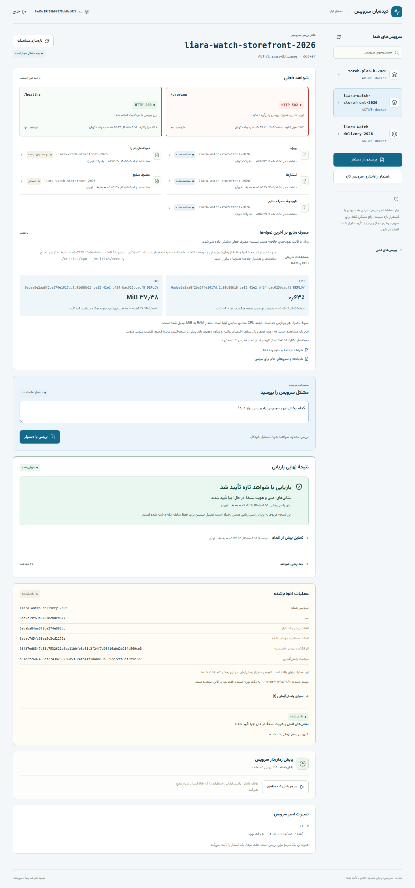
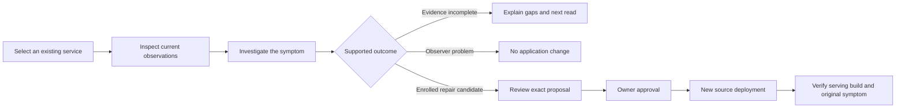

# دیده‌بان سرویس · Service Watch

**Know what failed. Verify what recovered.**

Liara service monitoring · Cited evidence · Bounded investigation · Explicit approval

[Run locally](docs/getting-started.md) · [User guide](docs/user-guide.md) · [Architecture](docs/architecture.md) · [Evaluation](docs/evaluation.md)

---

A running process does not mean its useful endpoint works. Service Watch helps a Liara customer inspect an existing service, investigate a symptom using supporting and contrary evidence, and approve a narrowly enrolled corrective deployment only when the evidence and capability allow it.

Existing services are welcome: **read-only investigation requires no healthy baseline, source archive or new deployment**. Workers without an HTTP endpoint are not automatically marked down.

> [!IMPORTANT]
> **Real Liara integration and an approved cloud recovery are recorded.** The operator has read actual inventory/logs/resource data, diagnosed a deliberate cloud dependency regression with genuine Codex, and verified an exact approved redeployment with three fresh rounds. The final-build unused-approval expiry, exact replacement and normal three-round recovery also passed; narrated presentation/public playback remain delivery gates. [Actual acceptance and its limits](docs/insured-vibe-coding/test-plans/live-liara.md).

*Actual Persian operator after recovery, reading the two disposable Liara services. The controlled cloud scenario and historical-resource qualifications are documented below.*

## Choose your route

| You want to… | Read |
|---|---|
| Understand what the customer can do | [User guide](docs/user-guide.md) |
| Run the demo from source | [Getting started](docs/getting-started.md) |
| Review the design and action boundary | [Architecture](docs/architecture.md) |
| Inspect integration claims | [Liara API capabilities](docs/api-capabilities.md) and [live QA](docs/insured-vibe-coding/test-plans/live-liara.md) |
| Assess results and failure cases | [Evaluation](docs/evaluation.md) |
| Connect an approved real account | [Deployment and owner setup](docs/deployment.md) |
| Prepare the presentation | [Demo sequence](docs/demo.md) and [submission evidence](submission.md) |
| Find configuration, endpoints or recovery steps | [Reference](docs/reference.md) |

[Complete documentation map](docs/README.md).

## From observation to a justified next step

The corrective branch is enabled only for explicitly enrolled targets with independently verified source and recovery policy. Other discovered services remain useful for read-only investigation. A separate, visibly labelled fixture mode supports local rehearsal.

| Capability | Customer outcome | Important boundary |
|---|---|---|
| Service inventory and notebook | Find a service and inspect its current evidence | A service needs no deployable artifact for diagnosis |
| HTTP and provider observations | Separate endpoint failure, process state and telemetry access | Unknown metrics are not green zeros |
| Active investigation | Ask a useful discriminating read and cite findings/contradictions | A recent release is not proof of causality |
| Bounded watch | Observe selected services for 15 minutes | Not a continuous monitoring/SaaS availability claim |
| Exact repair proposal | Review target, source hash, before-release, policy and expiry | Requires independently enrolled capability and a supported current diagnosis |
| Recovery verification | Check the new serving identity and original failure | Provider READY alone is insufficient |

## The demonstration incident

| Observation | Meaning |
|---|---|
| Storefront `/healthz` → **200** | The process responds |
| Storefront `/preview` → **502** | The configured useful endpoint fails |
| Delivery `/quote` → **200**, incompatible payload | Reachability does not prove the consumer contract is satisfied |
| Response key `delivery_toman` versus expected `shipping_toman` | Discriminating evidence of a dependency schema mismatch |

The fault is introduced by a separate owner-approved controller, not by the investigator. In actual cloud runs, Codex cited response/log evidence and retained uncertainty about onset, release causality and which service should change. The owner separately approved a known-good source deployment; the model had no write tool. Earlier abstention and inconclusive verification remain in the evidence rather than being rewritten as success.

## Evidence, not an unsupported success story

Recorded checks include **302 backend tests**, **14 frontend behavior tests**, **10 browser regressions**, **29/29 independent rendered UI cases**, and **8/8 expected cause-family or abstention outcomes** on separately labelled synthetic cases using genuine Codex. Local packaged containers also exercised a real healthy → dependency failure → restored-build sequence.

The cloud result is a deliberately introduced sandbox incident, with exact approvals, positive and negative evidence. These checks do not establish comparative production accuracy or improved MTTR. [Evaluation and practical limits](docs/evaluation.md) link to the raw results and explain what each layer proves.

<strong>Why the model cannot deploy by itself</strong>

The model runs in a disposable container and receives bounded, sanitized evidence and a registered read menu. It has no Liara token, operator database, fault-controller state or deployment tool. Application code validates citations, target identity, freshness and permitted outcomes. A separate trusted executor handles exact owner-approved writes and independent verification. [Architecture and trust boundaries](docs/architecture.md).

<strong>What is outside this MVP</strong>

No workplace Kubernetes connection, automatic topology discovery, native provider rollback, environment replacement, arbitrary shell/URL execution, automatic resizing, outbound alerts or continuous 24-hour monitoring. The operator stays local; only independently approved demo target services are intended for Liara hosting. Actual API/schema evidence and remaining platform limits are recorded in the capability document. Historical resource samples are explicitly separate from rejected future-dated summary data; no capacity or exhaustion claim is inferred from a snapshot.

## Project materials

[Reproducible setup](docs/getting-started.md) · [API reference](docs/reference.md) · [Detailed QA](docs/insured-vibe-coding/test-plans/operator-ui.md) · [Implementation history](docs/implementation-progress.md)

Built for the Starcoach Agentic AI Hackathon 2026 Liara challenge. Dependency versions are locked in the repository; no additional project-wide license grant is implied by this documentation.
