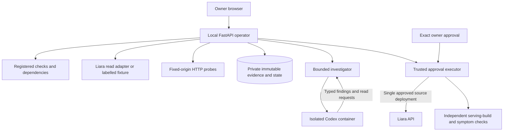
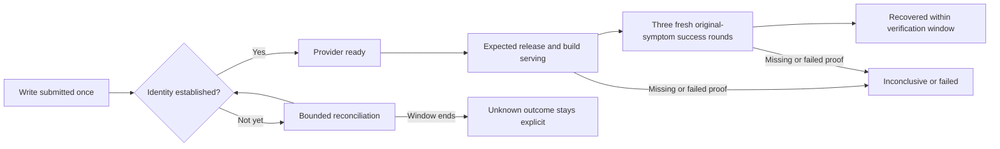

# Architecture and evidence boundaries

[← Documentation](README.md) · [API/configuration](reference.md) · [Evaluation](evaluation.md)

## Component and trust map

The provider branch is visibly simulated in the local rehearsal. The write branch is an implemented capability whose actual provider acceptance remains pending; it is not reachable merely because a service appears in inventory.

## Sessions and observations

The React interface talks to one local FastAPI operator. This is a single-owner instance. Its stable owner identity is separate from random signed HttpOnly session tokens; valid sessions recover the same watches, incidents, evidence and approvals. Logout revokes only that session, and a revoked cookie remains unauthorized. Mutation routes require the exact configured Origin. Private responses are not cached. The Liara bearer token stays in the operator process; fixtures have no mutation capability.

The owner registry declares HTTP origins/paths and explicit dependency relationships. Inventory itself comes from the provider and requires no source artifact or healthy baseline. Probes resolve once and connect to the approved IP with the original Host/TLS identity, reject redirects/private destinations in live mode, cap bodies at 4 KiB and preserve sanitized payloads, request IDs and acquisition times. HTTP failure, no endpoint, missing telemetry and observer authentication failures are distinct states.

## Evidence history and decision validity

SQLite stores immutable evidence and bounded observation sessions. Each incident has an append-only observation sequence and a separate material generation. Repeated equivalent failures advance observation history without invalidating an ongoing investigation; release/fingerprint/recovery changes invalidate old conclusions. Run IDs prevent a canceled or superseded model result from overwriting later work. Restart stops old watches and records unfinished investigations as interrupted.

## Investigation without mutation authority

Oversized model log excerpts retain the recent chronological tail as structured entries with timestamps and explicit omitted-line/truncated-message markers, bounded to4096UTF-8JSONbytes per payload. Full persisted evidence is unchanged. This prevents older log prefixes hiding the decisive newest request.

The investigator receives only evidence available by its cutoff, a registered read menu and a typed result schema. It may request a discriminating read, cite supporting/contrary evidence and propose an enrolled repair candidate. It cannot execute cloud operations. Codex runs in a disposable container with separate filesystem mounts and global queue/quota controls. The domain layer validates citations, targets, freshness and allowed outcomes independently of model text. Observer 401 forces no application change; unsupported/stale evidence may end unresolved.

## Exact actions and independent setup

The trusted operation executor persists the exact source intent before a write, freezes hash-verified bytes, checks current target/release/incident/policy, and writes once. A separate setup ledger creates only two explicitly named disposable demo apps. Initial deployment and baseline enrollment are separate: packaging is not healthy proof. The independent fault controller has its own archive/state and is never imported by the operator or registered as a model tool.

## Recovery is more than deployment readiness

Repair verification separately checks provider readiness, current/serving release identities, expected artifact build IDs, fresh echoed request IDs and the original configured symptom. Three complete success rounds at least five seconds apart must fit a 60-second / 12-probe budget. Reconciliation may continue for at most 10 minutes after a submitted write even if periodic watching expires. Restart during verification is inconclusive rather than a new unbounded attempt. Unknown write outcomes continue holding the target against another writer.

## Deliberate limitations

The declared service map is not automatic topology discovery; provider schemas and metric units need account-specific live acceptance; HTTP observations describe this operator’s vantage point; source redeployment is not native rollback; process health alone cannot establish customer-task health. The operator is deliberately local for personal model authentication. Production hosting, multi-user identity, alert delivery and an observability database are outside this MVP.

## Model source and reproducible image

The initial independent model module/tests were copied from our Torob commit 19ff3cf. Subsequent cancellation-create fixes were applied to both copies and verified separately; this product does not import or call the Torob server. Current codex_cli.py SHA-256:ade5457e89129584eeb1015ac57620e48d37a70c5a08bb070db643d8b4d4ea47; model_types.py SHA-256:3ae777a99da18054ba38e929d4387efccbb9eda296caa9b55d1f990f4bc627f7.

Current reproducible local image is `public.ecr.aws/docker/library/python:3.12-slim-bookworm@sha256:6a0e06f5ba0b373d051aabd3fffb9b873f27f9a2a3a14bcbe37dee6f0e3bbc70`. The image entrypoint is replaced with the read-only mounted Codex executable. A genuine schema proof on this image is recorded in [public-runtime-image.json](qa-evidence/public-runtime-image.json); the earlier eight-case evaluation used the earlier local runtime image and remains a separately labelled recorded run. No cloud model authentication was exported.

## Existing-state upgrade qualification

The owner identity is a domain-separated HMAC of the configured instance session secret. Keep that secret stable when restarting this single-owner instance. Pre-fix ephemeral-session owners are not silently merged or reassigned; their old QA records remain separate. Rotating the instance secret changes identity and requires deliberate migration planning. This is not a new multi-user authentication system.
