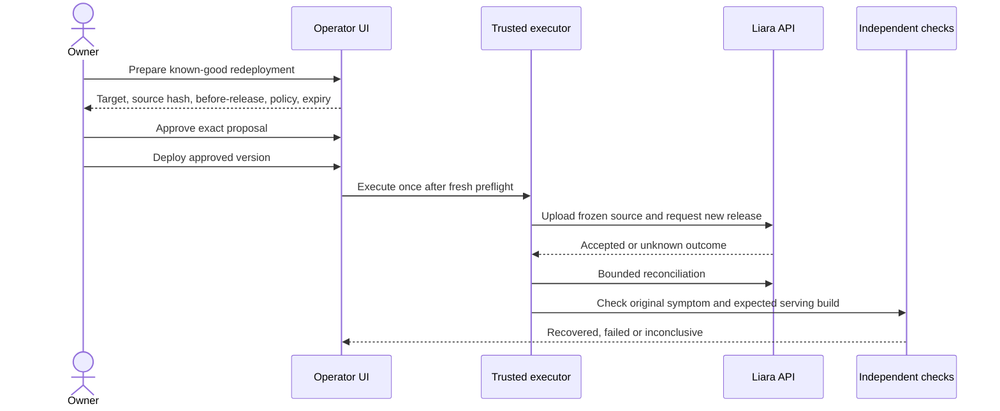

# User guide

[← Documentation](README.md) · [Run locally](getting-started.md) · [Demo sequence](demo.md)

**Observe first, investigate the symptom, approve only a justified action, then verify the result.** An investigation is useful even when it ends with a precise unknown rather than a deployment.

## Screen map

| Screen or panel | Use it for | Key control |
|---|---|---|
| Owner login | Open the private local operator | **ورود** |
| Service sidebar | Choose an existing service or reopen a record | **جست‌وجوی سرویس**; **بررسی‌های اخیر** |
| Overview | Compare endpoint and process/provider status; read diagnosis, observed impact and next action | **خلاصه و بررسی**; **تازه‌سازی وضعیت** |
| Resource charts | Inspect real past CPU/RAM samples by applet, times and verified units | **منابع** |
| Logs/evidence | Inspect source observations collected for this service | **لاگ و شواهد** |
| Code-agent handoff | Continue with the coding agent inside your own repository | **کپی متن برای Codex**; **دانلود فایل** |
| Investigation panel | Ask a bounded question and inspect citations | **بررسی با دستیار**; **لغو بررسی** |
| Evidence detail | Read human-readable observations first, with optional sanitized JSON audit | Copy evidence; close or Escape |
| Bounded watch | Observe configured checks for a limited period | **شروع پایش ۱۵ دقیقه‌ای**; **توقف پایش** |
| Recent provider changes | Find chronological leads | Inspect release evidence; do not infer causality from timing alone |
| Exact operation, when enrolled | Review a proposed source deployment and follow verification | Prepare → Approve → Deploy |

## 1. Sign in and select a service

Obtain the owner password privately from the access file generated during setup. Sign in before recording and close the password file. The sidebar's **جست‌وجوی سرویس** filters names; the refresh control reloads inventory. A service can be inspected immediately even if already failing or lacking a healthy baseline/source archive.

The local banner identifies provider metadata as simulated. Local HTTP probes and logs come from real demo processes. This is distinct from an authenticated Liara account connection.

## 2. Read observations without conflating them

Select **storefront**. In the faulty rehearsal scenario, `/healthz` returns **200** while `/preview` returns **502**. Click **شواهد** on each check to inspect response details and acquisition timestamps. Close evidence with its X or <kbd>Escape</kbd>.

| Observation | Valid conclusion | Invalid shortcut |
|---|---|---|
| Process check passes | The process answers this check | Every customer endpoint works |
| Useful endpoint fails | This configured check failed from the operator's vantage point | Every service or user is affected |
| Provider 401/403 | Monitoring access is unavailable | The observed service should be restarted |
| No configured HTTP check | HTTP coverage is absent | An endpoint-less worker is down |
| Metrics unavailable or units unknown | Capacity cannot be established from those readings | CPU/memory is healthy or exhausted |
| A recent release | A change merits investigation | The release caused the symptom |

Use **لاگ و شواهد** to open the source facts. The evidence dialog starts with readable observations; **جزئیات فنی · JSON** is closed until requested. The **releaseها** view contains release history; recent timing alone does not establish causality. **تازه‌سازی وضعیت** takes a new set. Collection time, evidence age and service health are separate facts.

The **منابع** view charts validated native historical CPU/RAM samples separately for each applet, with Tehran timestamps and sample counts. CPU uses the inspected Liara console units; RAM is converted from bytes to MiB. Invalid/future/out-of-window samples are omitted. A line breaks at an invalid observation or a gap longer than 60 seconds; no interpolation is claimed. A lone snapshot shows a single-sample notice rather than a decorative trend. Missing or unknown-unit data produces no invented zero or capacity claim. Invalid current summaries remain visibly invalid even when past history is usable.

The mobile **پرسیدن از دستیار** action jumps directly to the investigation question after observations load. Evidence timestamps now include the Persian-calendar date and explicit Tehran time.

## 3. Investigate the symptom

Use this question as a starting point:

> The process health endpoint succeeds, but /preview fails. Investigate the configured dependency and cite evidence for the cause. Do not change any service.

Click **بررسی با دستیار**. The UI reports actual collection/read names, completed reads, the model-call stage and response validation; it does not estimate a percentage. **لغو بررسی** stops further model work for that run; a stale or superseded result cannot become the current diagnosis.

Read **نتیجهٔ بررسی** for the short diagnosis, observed impact and next step. Detailed original model text, citations, unknowns and contrary evidence are available under **جزئیات نتیجه و شواهد**; collection history is collapsed separately.

To continue in your codebase, copy **کپی متن برای Codex** or download the same plain-text file with **دانلود فایل**. The handoff uses English instructions with the original Persian diagnosis and unknowns preserved unchanged. It includes the frozen diagnosis, cited same-service observations available by its cutoff and explicit unknowns. It asks your coding agent to inspect the repository, establish the cause, make a minimal fix and run a regression plus relevant project tests. It does not invent repository file paths or provide deploy permission. Raw response bodies/logs/configuration are excluded from the export. **دیدن متن قبل از کپی** opens selectable text when clipboard access is denied. Recovered incidents mark their handoff as historical and ask the coding agent to establish whether a current problem exists.

A genuine model call can take tens of seconds. Investigations have bounded reads/calls/time; repeated clicking does not make the evidence better. **AI configured** does not guarantee a successful call.

### The local dependency mismatch

Delivery can respond **200** on `/quote` yet return `delivery_toman` when storefront expects `shipping_toman`. That payload difference, correlated logs and the failing preview are useful discriminating evidence. The investigator does not receive the fault controller's answer key. It can still leave the intended contract, onset or correct repair target unknown.

Click **delivery** to inspect its checks, then return to storefront. **بررسی‌های اخیر** reopens records; fresh runs do not erase earlier evidence. Material changes invalidate old conclusions rather than silently reusing them.

For a current completed diagnosis, **حالا چه کار کنم؟** provides fixed, cause-specific owner steps with evidence links and the original failed check to repeat. On an unenrolled service these are manual guidance, not an executable repair plan. Changing the service generation invalidates the checklist with its diagnosis.

## 4. Try a bounded watch

Click **شروع پایش ۱۵ دقیقه‌ای**. Inspect its countdown and recorded probe count, then use **توقف پایش**. You do not need to wait 15 minutes in a demo. Watches stop automatically at expiry; restarting the operator does not silently resume an old watch. An already submitted deployment retains its own bounded reconciliation/verification window.

## 5. Understand why repair may be absent

The default is **فقط بررسی، بدون تغییر**. Both ordinary local fixture targets are un-enrolled. There is no prepare/deploy button for them, and a diagnosis is not permission to bypass this boundary.

After actual owner setup and capability enrollment, a supported current repair candidate can follow:

Inspect **سرویس هدف**, **تیم**, the before/submitted release, **SHA-256 سورس تأییدشده**, the verification-policy hash and expiry. Approval is single-use and expires after five minutes. After expiry or a material state change, prepare a fresh proposal. Never repeat an uncertain write blindly.

The correction is **a new deployment of registered source**, not an invented native rollback. Recovery requires the intended serving identity and three fresh original-symptom/build success rounds. READY alone is not success.

## 6. Rehearse and record honestly

| You can rehearse locally now | Requires actual cloud acceptance |
|---|---|
| Login, inventory and service context navigation | Authenticated Liara inventory/log/release/metric contracts |
| Real local 200-versus-502 failure | Real enrolled target baselines and independent cloud fault |
| Genuine Codex investigation and citations | Exact approved cloud redeployment |
| Watch start/stop and history | Fresh provider/serving/build recovery proof |

Keep the local/fixture banner visible in local footage. The [demo plan](demo.md) describes the final five-minute story; [LIVE1–LIVE5](insured-vibe-coding/test-plans/live-liara.md) record whether the actual provider gates passed.

## Initial setup guidance

Open **راهنمای راه‌اندازی سرویس تازه** from the service sidebar. Select web, background worker or static website and enter explicit minimum RAM/CPU/disk requirements. Submit to read the account catalogue and match an available plan; changing an input clears the old recommendation. Unavailable access and no matching plan remain explicit, with no invented price or zero default. The guide covers deployment method, private configuration, default-domain verification and manual custom-domain DNS/HTTPS checks. It never provisions, resizes, changes DNS or deploys. The separately approved owner setup ledger remains the only initial demo provisioning path.
